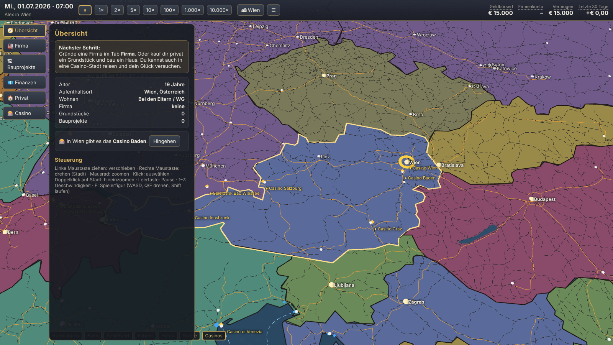
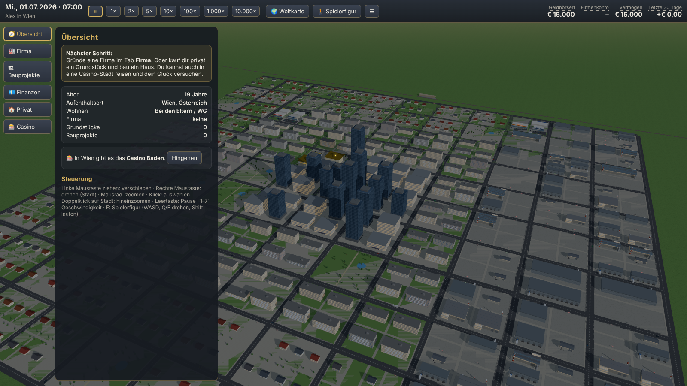
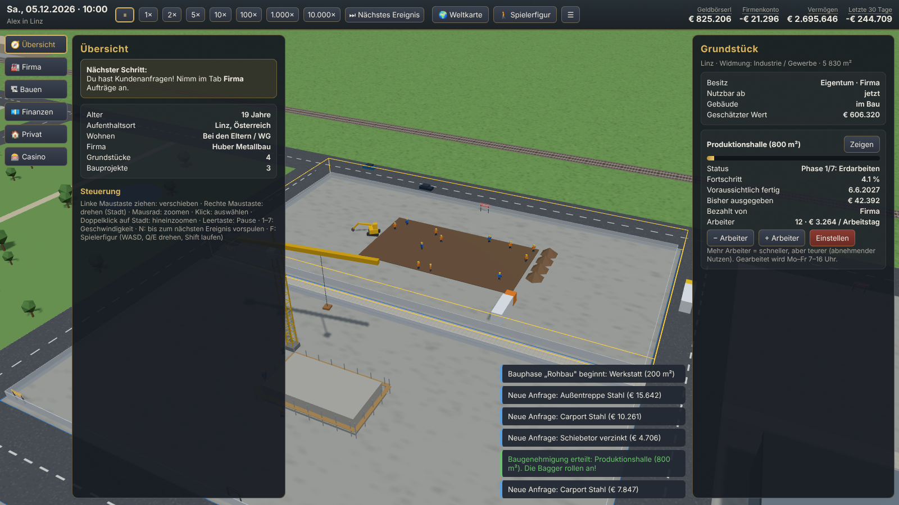

# World Sim – Industrie & Leben

Ein Wirtschafts- und Lebenssimulator auf einer echten Weltkarte. Du startest als Schulabsolvent:in in einem Land deiner Wahl, gründest eine Firma, kaufst Grundstücke, baust Hallen mit realistischer Bauzeit, nimmst Aufträge an, kaufst dir privat ein Haus oder spielst im Casino.

- Anforderungen: [docs/ANFORDERUNGEN.md](docs/ANFORDERUNGEN.md)
- Entwicklungsplan: [docs/ENTWICKLUNGSPLAN.md](docs/ENTWICKLUNGSPLAN.md)
- Datenquellen: [ATTRIBUTION.md](ATTRIBUTION.md)

| Weltkarte | Stadt | Baustelle |
|---|---|---|
|  |  |  |

## Aufbau

| Ordner | Inhalt |
|---|---|
| `WorldSim/` | **Unreal-Engine-5.7-Projekt** (Hauptweg). C++-Simulationskern + Weltkarte, Stadt, Kamera, HUD. Start: [WorldSim/SETUP.md](WorldSim/SETUP.md) |
| `prototype-web/` | Spielbarer Browser-Prototyp (TypeScript, Three.js), von dem der Kern portiert wurde |

### Unreal

Siehe [WorldSim/SETUP.md](WorldSim/SETUP.md). Simulationstests ohne Engine: `cd WorldSim && bash Tests/run.sh`.

### Web-Prototyp

```bash
cd prototype-web
npm install
npm run dev      # http://localhost:5173
npm test         # Simulationstests
```

Die Kartendaten liegen fertig in `prototype-web/public/data/`. Neu erzeugen aus Natural Earth: `npm run prepare-data`.

### Steuerung (Web-Prototyp)

| Aktion | Eingabe |
|---|---|
| Karte verschieben | linke Maustaste ziehen |
| Drehen (Stadt) | rechte Maustaste ziehen |
| Zoomen | Mausrad (Weltkarte → Stadt durch Hineinzoomen oder Doppelklick auf eine Stadt) |
| Pause / Geschwindigkeit | Leertaste / Tasten 1–7 (1×, 2×, 5×, 10×, 100×, 1.000×, 10.000×) |
| Bis zum nächsten Ereignis vorspulen | N |
| Spielerfigur | F, dann WASD, Q/E drehen, Shift laufen |

## Stand (Phase 1, Prototyp)

- Weltkarte mit echten Grenzen, Städten, Autobahnen, Bahnlinien, Häfen, Fähren und Haupt-Schifffahrtsrouten
- Prozedurale 3D-Städte um echte Stadtzentren mit Wohn-, Geschäfts- und Industriegebieten, echten Handelsketten (nur Namen) und echten Casinos
- Firmengründung mit Behördenschritten je Land (Einzelunternehmen / GmbH), Geldbörserl und Firmenkonto getrennt
- Grundstücke kaufen oder Hallen mieten, Baugenehmigung, Bau in Phasen mit sichtbaren Maschinen und Arbeitern, laufende Löhne und Maschinenmieten
- Aufträge (Schlosserei, Tischlerei, Kfz-Werkstatt), Personal, Kredite, Lebenshaltungskosten
- Europäisches Roulette mit echten Wahrscheinlichkeiten, Selbstsperre
- Tag/Nacht, Verkehr, Speichern im Browser
